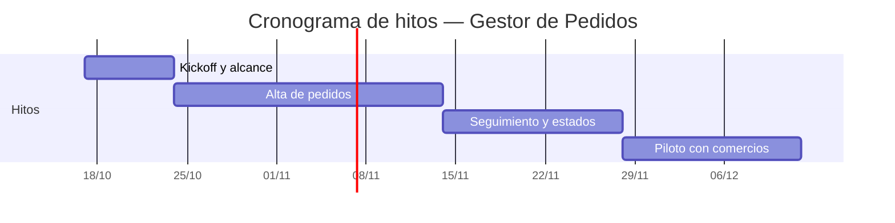

> **Documento:** Cronograma de Hitos · **Fase:** Planificacion · **Versión:** 1.0 · **Fecha:** 2026-10-17 · **Autor:** Equipo de Producto · **Estado:** Borrador

## Control de versiones

| Versión | Fecha | Autor | Cambios |
|---|---|---|---|
| 1.0 | 2026-10-17 | Equipo de Producto | Versión inicial |

# Cronograma de Hitos

## Diagrama de Gantt de hitos

## Hitos

| Hito | Semana de inicio | Duración (semanas) | Entregable |
|---|---|---|---|
| Kickoff y alcance | 1 | 1 | Acta y alcance acordados |
| Alta de pedidos | 2 | 3 | Modulo de alta funcionando |
| Seguimiento y estados | 5 | 2 | Tablero por estado disponible |
| Piloto con comercios | 7 | 2 | Retroalimentacion del piloto |

## Dependencias

- El tablero depende del registro de cambio de estado
- La exportacion depende de los filtros de busqueda
