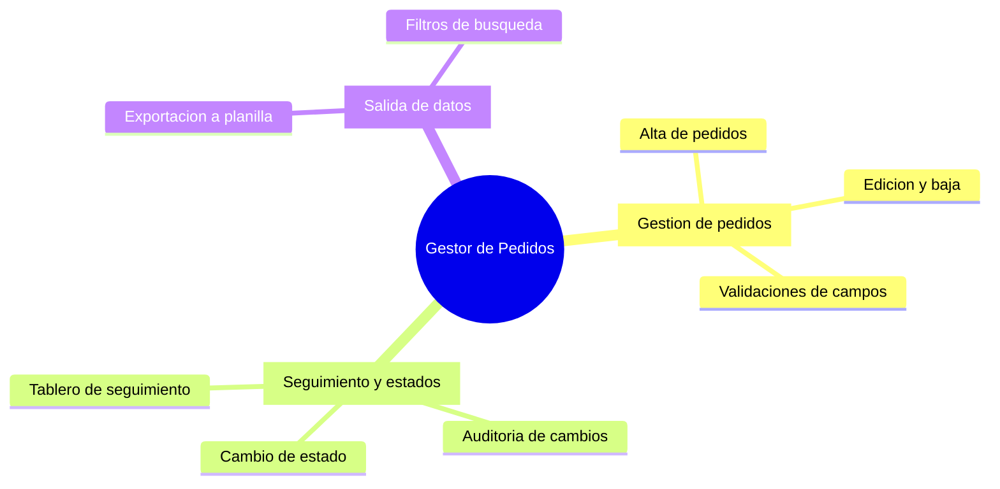

> **Documento:** EDT / Epicas · **Fase:** Planificacion · **Versión:** 1.0 · **Fecha:** 2026-10-17 · **Autor:** Equipo de Producto · **Estado:** Borrador

## Control de versiones

| Versión | Fecha | Autor | Cambios |
|---|---|---|---|
| 1.0 | 2026-10-17 | Equipo de Producto | Versión inicial |

# EDT / Epicas

## Paquetes de trabajo

| ID | Epica | Paquetes de trabajo |
|---|---|---|
| E1 | Gestion de pedidos | Alta de pedidos; Edicion y baja; Validaciones de campos |
| E2 | Seguimiento y estados | Cambio de estado; Auditoria de cambios; Tablero de seguimiento |
| E3 | Salida de datos | Exportacion a planilla; Filtros de busqueda |

## Mapa de épicas

