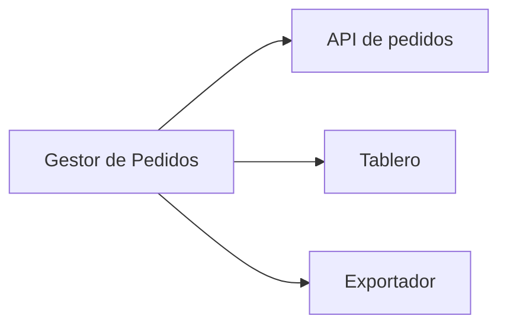

> **Documento:** Arquitectura de la Solucion · **Fase:** Tecnico · **Versión:** 1.0 · **Fecha:** 2026-10-17 · **Autor:** Equipo de Producto · **Estado:** Borrador

## Control de versiones

| Versión | Fecha | Autor | Cambios |
|---|---|---|---|
| 1.0 | 2026-10-17 | Equipo de Producto | Versión inicial |

# Arquitectura de la Solucion

## Diagrama de módulos

## Stack

- TypeScript
- Node.js
- PostgreSQL
- React

## Módulos y responsabilidades

| Módulo | Responsabilidad |
|---|---|
| API de pedidos | Expone el alta, la edicion y el cambio de estado |
| Tablero | Consume los pedidos y muestra el estado por columna |
| Exportador | Genera la planilla a partir de los pedidos filtrados |

## Integraciones

- Autenticacion corporativa
- Almacenamiento de archivos exportados

## Despliegue

- Contenedor unico
- Base de datos gestionada
- Despliegue automatizado por rama
