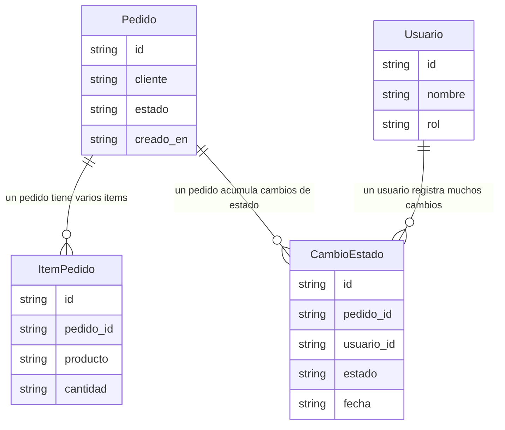

> **Documento:** Modelo de Datos · **Fase:** Tecnico · **Versión:** 1.0 · **Fecha:** 2026-10-17 · **Autor:** Equipo de Producto · **Estado:** Borrador

## Control de versiones

| Versión | Fecha | Autor | Cambios |
|---|---|---|---|
| 1.0 | 2026-10-17 | Equipo de Producto | Versión inicial |

# Modelo de Datos

## Diagrama entidad-relación

## Entidades y campos

| Entidad | Campos |
|---|---|
| Pedido | id, cliente, estado, creado_en |
| ItemPedido | id, pedido_id, producto, cantidad |
| Usuario | id, nombre, rol |
| CambioEstado | id, pedido_id, usuario_id, estado, fecha |

## Relaciones

| Origen | Destino | Cardinalidad | Descripción |
|---|---|---|---|
| Pedido | ItemPedido | 1-N | un pedido tiene varios items |
| Pedido | CambioEstado | 1-N | un pedido acumula cambios de estado |
| Usuario | CambioEstado | 1-N | un usuario registra muchos cambios |
