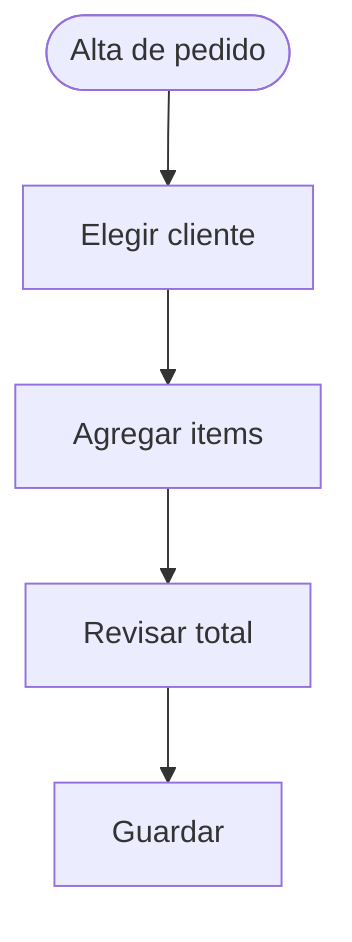
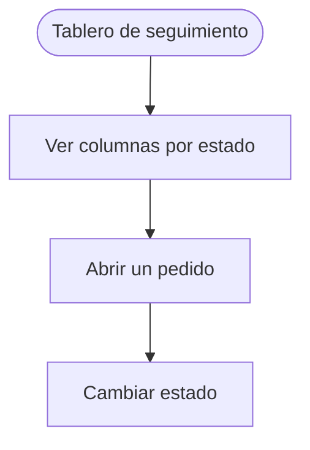

> **Documento:** UX y Wireframes · **Fase:** Tecnico · **Versión:** 1.0 · **Fecha:** 2026-10-17 · **Autor:** Equipo de Producto · **Estado:** Borrador

## Control de versiones

| Versión | Fecha | Autor | Cambios |
|---|---|---|---|
| 1.0 | 2026-10-17 | Equipo de Producto | Versión inicial |

# UX y Wireframes

## Flujos por vista

## Vistas

### Alta de pedido

Cargar un pedido validando los campos obligatorios

- Elegir cliente
- Agregar items
- Revisar total
- Guardar

### Tablero de seguimiento

Mover pedidos entre estados y ver la carga por columna

- Ver columnas por estado
- Abrir un pedido
- Cambiar estado
